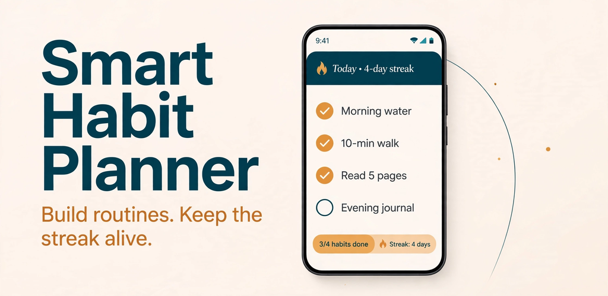
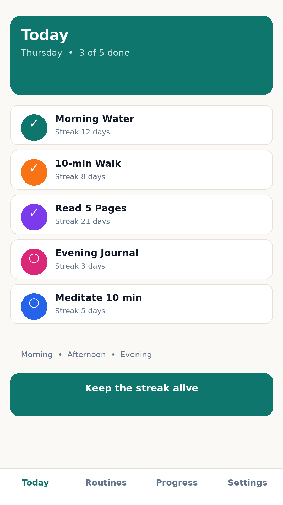
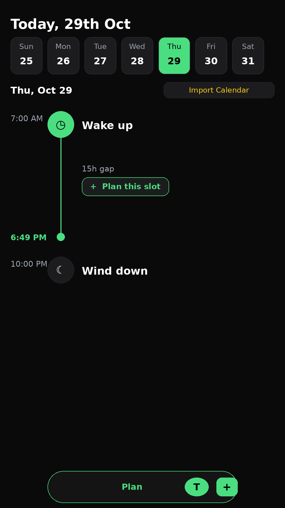
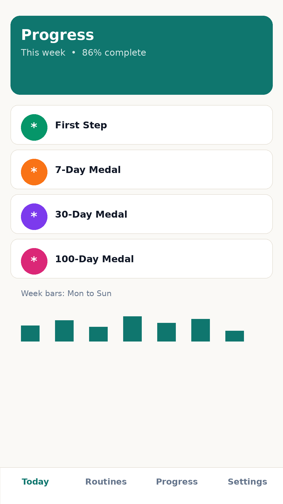
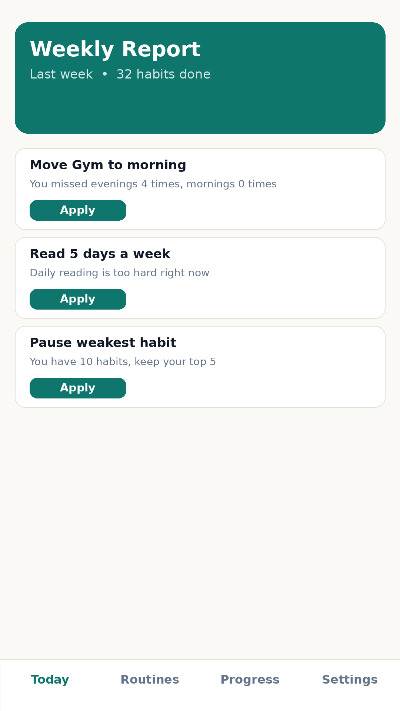

# Smart Habit Planner


A complete, offline-first Expo (React Native) app for building routines,
tracking habits, keeping streaks alive, and getting one small, data-based
suggestion every week.

## App logo and Play Store images

| Image | File | Size |
| --- | --- | --- |
| App icon (Play Store) | `store-assets/app-icon-512.png` | 512 x 512 PNG |
| Feature graphic | `store-assets/feature-graphic.png` | 1024 x 500 PNG |
| Splash screen | `store-assets/splash.png` | 1080 x 1920 PNG |
| Screenshot: Today list | `store-assets/screenshot-1-today.png` | 1080 x 1920 PNG |
| Screenshot: Streak view | `store-assets/screenshot-2-streak.png` | 1080 x 1920 PNG |
| Screenshot: Progress and medals | `store-assets/screenshot-3-progress.png` | 1080 x 1920 PNG |
| Screenshot: Weekly report | `store-assets/screenshot-4-weekly.png` | 1080 x 1920 PNG |








Expo runtime assets live in `assets/`: `icon.png`, `adaptive-icon.png`,
`splash-icon.png` (1024 x 1024 PNG), `splash.png` (1080 x 1920 PNG) and
`favicon.png` (64 x 64 PNG). The screenshots above are clean mockups in
the app's own colours and wording, made to match the redesigned UI, not
copies of any other app's screenshots.

## Run it

```bash
npm install
npx expo start
```

Then open it in Expo Go on an Android phone, or press `a` for an Android
emulator. The app is Android-first but the code has no Android-only UI code.

## Android build notes

- Package: `com.smarthabit.planner` (see `app.json`)
- Development build / EAS (from the project root, once EAS is configured):

```bash
npx eas build -p android --profile preview
```

- A local release bundle can also be produced with `npx expo export
  --platform android` (verified in this workspace, see below). That export
  is a JS bundle, not a signed AAB for the Play Store; a Play release still
  needs an EAS/cloud build or a local Gradle build with signing keys.

## What is implemented (all 14 screens from the agreed flow)

- Splash, Onboarding (5 interactive steps: pick Tick or Measurable, create a real first habit, create a real task, set a daily reminder with Save Habit, then a summary of both)
- Tasks tab: Timeline view grouped by date, All Tasks grouped by list and priority with subtask counts, Plan day with week strip, timed timeline, gaps with Plan this slot, and a task creation sheet (title, date, time, reminder, Repeat, list, priority, sub-tasks). Checking all sub-tasks auto-finishes the task. Repeat (Daily/Weekly) and Import Calendar are PRO-gated and open the paywall on Free; real calendar import is not yet implemented.
- Today (home): habits grouped Morning / Afternoon / Evening, tap to
  complete or undo, progress ring/bar, missed-yesterday banner, reminder
  rationale card
- Habit Detail: current/best streak, 7-day and 30-day completion, 3-month
  grid, measurable logging, pause, planned skip, edit, delete (confirmed)
- Add/Edit Habit: Do / Avoid / Measurable, daily / specific weekdays /
  X-times-per-week, time slot, reminder time, colour
- Routines list, Routine Detail, and Run Mode (step-by-step Done/Next;
  finishing marks each habit done on Today, with no double counting)
- Create/Edit Routine: pick habits, reorder with up/down controls
- Progress: week bars, 12-week heatmap, all habits weakest-first
- Weekly Report: last-week summary plus rule-based suggestions with
  working Apply buttons (move to morning, change to 5 days a week, pause)
- Paywall: dark premium screen with crown, Free vs Premium comparison, orange PRO badges, Monthly / Yearly (Best Value) / Lifetime, Restore, close. PRO badges also show in Habit Form at the free limit and in Settings.
- Settings: notification permission (rationale first, then system prompt),
  evening review time, backup note, demo Premium preview switch, delete
  all data with double confirmation

Bottom tabs: Today, Tasks, Routines, Progress, Settings, with a central + button
that opens New Habit, New Routine, or New Task. Default theme is Dark for new
users; Light is still available in Settings.

## Rules implemented

- Streaks: Done = +1, Missed (a past due day left undone) = reset to 0,
  Skip (planned in advance) = does not break the streak.
- Midnight rollover needs no stored "missed" rows: any past due day that is
  not done and not skipped counts as missed, so yesterday's misses appear
  on Today automatically.
- All data lives in AsyncStorage on the phone: habits, routines, check-ins,
  skips, settings, onboarding flag. No backend in v1.

## Free vs Premium

- Free: max 5 habits, 1 routine, basic streaks and calendar, week bars and
  heatmap, reminders, skips and pauses.
- Premium: unlimited habits and routines, advanced charts, weekly
  suggestions with Apply buttons.

The paywall gates trigger at the 6th habit and the 2nd routine. In v1 the
purchase and restore buttons are honest placeholders: they show a
"not wired yet" message and do **not** charge or unlock anything.
Settings has a clearly labelled demo-only preview switch so the gates can
be tested without faking a purchase.

## TODO for v2

- RevenueCat: wire purchase + restore in `src/screens/Paywall.tsx`, and
  unlock Premium only after a verified purchase. Remove the demo preview
  switch before a public release.
- Cloud sync / backup (Supabase or similar) — Settings already says this
  is not available in v1, so users are not promised it.
- AI weekly suggestions (replacing the current rule-based suggestions in
  `src/lib/suggestions.ts`).
- Home-screen widgets (Android) and richer reminder options.
- Tests: the streak and suggestion logic in `src/lib/` is written as pure
  functions and is the first place to add unit tests.

## Verification (this workspace)

- `npx tsc --noEmit` — passes, zero errors.
- `npx expo export --platform android` — passes; bundle built (801 modules, 1.9MB). The `dist/` output was cleaned up after verification, so re-run the export to regenerate it.
